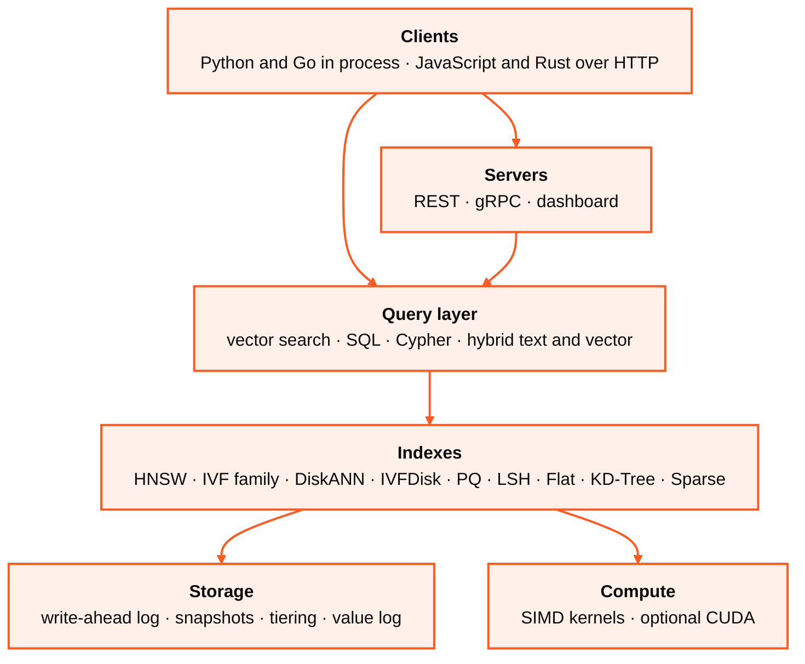

<p align="center">
  <picture>
    <source media="(prefers-color-scheme: dark)" srcset="assets/banner-dark.svg">
    <source media="(prefers-color-scheme: light)" srcset="assets/banner-light.svg">
    
  </picture>
</p>

<p align="center">
  <a href="https://github.com/jaywyawhare/GigaVector/actions/workflows/deploy-website.yml"></a>
</p>

<p align="center">
  <a href="https://pypi.org/project/gigavector/"></a>
  <a href="python/pyproject.toml"></a>
  <a href="CMakeLists.txt"></a>
  <a href="LICENCE"></a>
  <a href="https://pepy.tech/projects/gigavector"></a>
  <a href="https://github.com/jaywyawhare/GigaVector"></a>
</p>

<p align="center">
  <a href="https://jaywyawhare.github.io/GigaVector/">Website</a> ·
  <a href="#documentation">Docs</a> ·
  <a href="docs/python_bindings.md">Python</a> ·
  <a href="docs/c_api_guide.md">C API</a> ·
  <a href="#clients">Clients</a> ·
  <a href="https://github.com/jaywyawhare/GigaVector/releases">Releases</a>
</p>

GigaVector is a vector database library written in C11, with Python bindings. It
is for developers who want vector search inside their own process, from Python or
C, or behind a small REST server. Vector indexes, full-text search, a property
graph and durable storage share one engine, so you don't need to run a separate
service for each.

## Install

```bash
pip install gigavector
```

To build from source with GCC or Clang, run `make lib` (or use CMake). The PyPI package
does not include the C REST server; that needs a source build with libmicrohttpd. See the
[build and test guide](docs/build_and_test.md) for details.

## Quick start

```python
from gigavector import Database, DistanceType, IndexType

with Database.open("example.db", dimension=4, index=IndexType.HNSW) as db:
    db.add_vector([0.1, 0.2, 0.3, 0.4], metadata={"category": "a"})
    db.add_vector([0.9, 0.1, 0.0, 0.2], metadata={"category": "b"})

    for hit in db.search([0.1, 0.2, 0.3, 0.5], k=2, distance=DistanceType.COSINE):
        print(hit.id, round(hit.distance, 4))

    db.save()  # write a snapshot to example.db before the block closes the handle
```

The [usage guide](docs/usage.md) covers the rest of the Python API; the
[C API guide](docs/c_api_guide.md) shows the same steps in C.

## Features

| Area | What's included |
|------|-----------------|
| Search | k-NN · range · batch · metadata filters · hybrid BM25 and vector · SQL · MMR diversity · grouping · geo · ColBERT late interaction · recommendations |
| Text search | Full-text search with stemming for six languages · BlockMax WAND · phrase matching · learned sparse (SPLADE style) |
| Storage | Write-ahead log with replay · atomic snapshots · point-in-time snapshots · collection versioning · hot, warm and cold tiering · value log |
| Transactions | MVCC snapshot isolation · crash-atomic commit · transactions over REST · automatic tombstone cleanup |
| Quantization | PQ and OPQ · scalar 8-bit · TurboQuant · binary · RaBitQ · 1.5 to 8 bit codes |
| Distributed | REST and gRPC servers · TLS · Raft replication with failover · sharding and resharding · namespaces · per-tenant quotas · streaming ingestion |
| Security | API keys and JWT · read-only and read-write scopes · read-only server mode · OIDC single sign-on · encrypted backups |
| Graph | Property graph with traversal and analytics · knowledge graph with entity embeddings · Cypher subset · GraphRAG context expansion |
| AI integration | OpenAI, Anthropic and Gemini clients · embedding services · semantic memory layer · ONNX model serving · Markdown, HTML and PDF ingestion |
| Observability | Prometheus metrics · structured access logs · query tracing · health checks · latency histograms |
| Acceleration | SIMD distance kernels · optional CUDA with multi-GPU batches · built-in slab allocator |

The [feature specification](FEATURE_SPEC.md) describes each of these in detail.

## Indexes

| Index | Best for |
|-------|----------|
| HNSW | General use, high recall |
| IVF-PQ · IVF-Flat · IVF-SQ8 · IVF-TurboQuant | Large datasets, trading memory against recall |
| DiskANN · IVFDisk | Data larger than RAM |
| PQ · LSH | Compressed or hash-based approximate search |
| Flat · KD-Tree | Exact search on small or low-dimensional data |
| Sparse | Sparse vectors such as BM25 |

GigaVector can also [pick the index for you](docs/performance.md#dual-mode-index-selection-in-memory-vs-on-disk)
from the data size and a memory budget.

Distance metrics: Euclidean, cosine, dot product, Manhattan and Hamming, with SSE4.2,
AVX2, AVX-512, FMA and NEON kernels chosen at runtime.

## Architecture



## REST API

Needs a source build with libmicrohttpd. The server rejects everything but `/health`
until you set an API key.

```python
from gigavector import Database, IndexType, Server, ServerConfig

db = Database.open("vectors.db", dimension=4, index=IndexType.HNSW)
server = Server(db, ServerConfig(port=6969, api_key="change-me"))
server.start()
```

| Method | Path | Description |
|--------|------|-------------|
| `GET` | `/health` | Health check |
| `GET` | `/stats` | Database statistics |
| `GET` | `/metrics` | Prometheus metrics |
| `POST` | `/vectors` | Add vectors |
| `GET` `PUT` `DELETE` | `/vectors/{id}` | Get, update or delete by index |
| `POST` | `/search`, `/search/range`, `/search/batch` | k-NN, range and batch search |
| `POST` | `/txn/begin`, `/txn/commit`, `/txn/rollback` | Transactions |
| `POST` | `/compact`, `/save` | Compaction, persist to disk |

For a web dashboard with the PyPI package, call `serve_with_dashboard(db)` and open `/dashboard`.

## Clients

| Language | Transport | Notes | Guide |
|----------|-----------|-------|-------|
| Python | In process (CFFI) | Full API over the C library | [Python guide](clients/python/README.md) |
| Go | In process (cgo) | Links the C library directly, no server | [Go guide](clients/go/README.md) |
| JavaScript | REST | `fetch` client for the HTTP server | [JavaScript guide](clients/js/README.md) |
| Rust | REST | Standard library only, pooled keep-alive connections | [Rust guide](clients/rust/README.md) |

## Documentation

| Topic | Guides |
|-------|--------|
| Start here | [Usage](docs/usage.md) · [Python bindings](docs/python_bindings.md) · [C API guide](docs/c_api_guide.md) · [API reference](docs/api_reference.md) |
| Operate | [Deployment](docs/deployment.md) · [Security](docs/security.md) · [Performance](docs/performance.md) · [Troubleshooting](docs/troubleshooting.md) |
| Internals | [Architecture](docs/architecture.md) · [Lock ordering](docs/lock_ordering.md) · [Build and test](docs/build_and_test.md) |
| Contribute | [Contributing](CONTRIBUTING.md) |

The LLM and embedding tests need API keys; the [build and test guide](docs/build_and_test.md#environment-variables) lists them.

## License

GigaVector is released under the [Don't Be A Jerk General Public License (DBaJ-GPL)](LICENCE).
